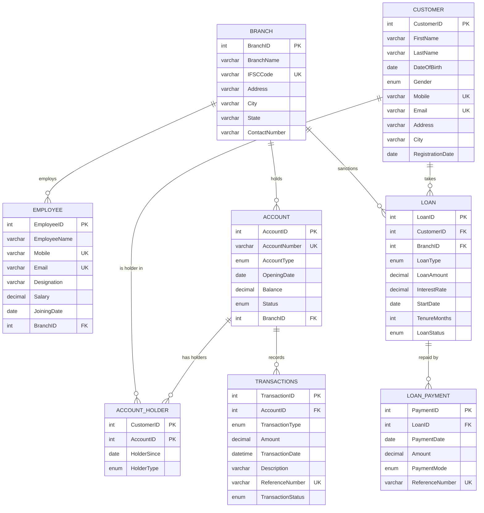

# Project Kashi - Banking Management System: Documentation

**Tech stack:** HTML + CSS (frontend) | Flask / Python (backend) | MySQL (database)
**Purpose:** learn how a frontend, a backend and a database are created and connected. It is not a real bank.

---

## 1. Workflow (three-layer flow)

```
Browser (HTML form)  --->  Flask route in app.py  --->  MySQL (tables, procedures, triggers)
   user types data        validates + sends SQL         stores data, checks rules
Browser (HTML page)  <---  Flask renders template  <---  returns rows / error message
```

Example - **Deposit**
1. User opens `/deposit`, picks an account, types the amount, clicks *Deposit* (HTML form, `method="POST"`).
2. Flask route `deposit()` checks the amount is a valid number and calls the stored procedure `sp_deposit`.
3. MySQL starts a transaction, inserts a row in `transactions`, adds the amount to `account.Balance`, and COMMITs. If anything fails, it ROLLBACKs.
4. Flask shows a green "Deposit successful" message (or the red error text coming from MySQL).

Example - **Open account (new customer)**
1. `/customers/new` -> row saved in `customer` (the trigger blocks anyone under 18).
2. Flask redirects to `/accounts/new` -> one database transaction inserts into `account`, `account_holder` and (if there is an opening deposit) `transactions`.

---

## 2. ER Diagram

(Shown automatically on GitHub. You can also redraw it in draw.io, or in MySQL Workbench: *Database -> Reverse Engineer*.)



---

## 3. Relationships and Cardinality

| # | Relationship | Cardinality | How it is implemented |
|---|---|---|---|
| 1 | Branch - Employee | One-to-Many (1:N) | `employee.BranchID` is a FK to `branch` |
| 2 | Branch - Account | One-to-Many (1:N) | `account.BranchID` is a FK to `branch` |
| 3 | Branch - Loan | One-to-Many (1:N) | `loan.BranchID` is a FK to `branch` |
| 4 | Customer - Account | **Many-to-Many (M:N)** | A customer can have many accounts; an account can have many (joint) holders. Broken into two 1:N using the bridge table `account_holder` (composite PK = CustomerID + AccountID) |
| 5 | Account - Transactions | One-to-Many (1:N) | `transactions.AccountID` is a FK to `account` |
| 6 | Customer - Loan | One-to-Many (1:N) | `loan.CustomerID` is a FK to `customer` |
| 7 | Loan - Loan_Payment | One-to-Many (1:N) | `loan_payment.LoanID` is a FK to `loan` |

Rule to remember: **the FK always sits on the "many" side.**

---

## 4. Tables (data types and constraints)

| Table | Primary Key | Foreign Keys | Other constraints |
|---|---|---|---|
| customer | CustomerID (auto increment) | - | Mobile UNIQUE + CHECK 10 digits, Email UNIQUE, NOT NULL on all details |
| branch | BranchID | - | IFSCCode UNIQUE |
| employee | EmployeeID | BranchID -> branch | Salary CHECK > 0, Mobile / Email UNIQUE |
| account | AccountID | BranchID -> branch | AccountNumber UNIQUE, Balance CHECK >= 0, AccountType ENUM(Saving, Current, Salary), Status ENUM(Active, Inactive, Close) |
| account_holder | (CustomerID, AccountID) | CustomerID -> customer, AccountID -> account | HolderType ENUM(Primary, Joint) |
| transactions | TransactionID | AccountID -> account | Amount CHECK > 0, ReferenceNumber UNIQUE, TransactionType ENUM(DEPOSIT, WITHDRAWAL, TRANSFER_IN, TRANSFER_OUT) |
| loan | LoanID | CustomerID -> customer, BranchID -> branch | LoanAmount > 0, InterestRate >= 0, TenureMonths > 0, LoanType ENUM(Home, Education, Personal, Vehicle) |
| loan_payment | PaymentID | LoanID -> loan | Amount > 0, ReferenceNumber UNIQUE, PaymentMode ENUM(Cash, UPI, NetBanking, Cheque) |

Why `DECIMAL(15,2)` for money? `FLOAT` gives rounding errors (0.1 + 0.2 != 0.3). DECIMAL is exact, so it is the correct type for money.
The table is named `transactions` (not `transaction`) because TRANSACTION is a SQL keyword.

---

## 5. Normalization

* **1NF** - every column holds one value (no lists); every row is identified by a primary key.
* **2NF** - no partial dependency. In `account_holder` (composite key) both `HolderSince` and `HolderType` depend on the *whole* key (customer + account).
* **3NF** - no transitive dependency. Branch details (name, IFSC, city) are stored once in `branch`, not repeated in `account`, `employee` or `loan`. Customer details are stored once in `customer`.

---

## 6. Database objects

### Views
| View | What it shows |
|---|---|
| `vw_account_summary` | Account + branch name + holder names (joins 4 tables) |
| `vw_transaction_history` | Transactions with the account number |
| `vw_loan_summary` | Loan + total paid + outstanding amount |

### Stored functions
| Function | Purpose |
|---|---|
| `fn_get_balance(account_id)` | Returns the balance of an account |
| `fn_calculate_emi(amount, rate, months)` | EMI = P x r x (1+r)^n / ((1+r)^n - 1), r = rate / 12 / 100 |

### Stored procedures (each is one SQL transaction)
| Procedure | What it does |
|---|---|
| `sp_deposit` | Inserts DEPOSIT row + increases balance |
| `sp_withdraw` | Checks balance, inserts WITHDRAWAL row + decreases balance |
| `sp_transfer` | Inserts TRANSFER_OUT and TRANSFER_IN rows, updates both balances - all or nothing |
| `sp_pay_loan` | Inserts a loan payment (trigger may close the loan) |

### Triggers
| Trigger | Event | Rule |
|---|---|---|
| `trg_customer_age_check` | BEFORE INSERT on customer | Customer must be 18 or older |
| `trg_check_account_active` | BEFORE INSERT on transactions | No transaction on an Inactive / Closed account |
| `trg_close_loan` | AFTER INSERT on loan_payment | Sets loan to Closed when total paid >= loan amount |

### Transactions (ACID)
`START TRANSACTION ... COMMIT / ROLLBACK`. Example: in a transfer, if crediting the second account fails, the debit of the first account is rolled back. Money is never lost or created.
* **A**tomicity - all steps happen or none. **C**onsistency - rules (CHECK, FK) always hold. **I**solation - `SELECT ... FOR UPDATE` locks the account row so two people cannot change the same balance at the same time. **D**urability - after COMMIT the data stays saved.

---

## 7. The 10+ business problems solved by SQL

All are in `database/queries.sql` and run live on the **Reports** page of the website.

1. Total balance in each branch (JOIN, GROUP BY)
2. Top 5 accounts by balance (ORDER BY, LIMIT)
3. Customers with more than one account (GROUP BY, HAVING)
4. Customers with no account (LEFT JOIN, IS NULL)
5. Total amount per transaction type (GROUP BY)
6. Transactions above the average amount (subquery)
7. Employees and average salary per branch (JOIN, AVG)
8. Outstanding loan per customer (view)
9. Accounts that are not Active (WHERE)
10. Deposits per month (DATE_FORMAT, GROUP BY)
11. Accounts with their holders (view) *(extra)*
12. Calling stored functions `fn_get_balance` and `fn_calculate_emi` *(extra)*

---

## 8. Definitions (for the viva)

* **DBMS** - software that stores, manages and retrieves data (MySQL).
* **Entity / Attribute** - a thing we store data about (Customer) / its properties (FirstName).
* **Primary key** - uniquely identifies a row; cannot be NULL or repeated.
* **Foreign key** - a column that points to the primary key of another table; keeps data connected and valid.
* **Candidate / Unique key** - another column that must be unique (Email, AccountNumber).
* **Composite key** - a key made of 2+ columns (CustomerID + AccountID).
* **Constraint** - a rule on data: NOT NULL, UNIQUE, CHECK, PRIMARY KEY, FOREIGN KEY, DEFAULT.
* **Cardinality** - how many rows of one table can relate to rows of another (1:1, 1:N, M:N).
* **Join** - combining rows of two or more tables using a related column (INNER, LEFT).
* **View** - a saved SELECT query that works like a virtual table.
* **Stored procedure** - saved SQL code that you CALL; can change data. **Stored function** - saved code that returns a single value and is used inside a SELECT.
* **Trigger** - code that MySQL runs automatically before/after INSERT, UPDATE or DELETE.
* **Transaction** - a group of SQL statements that succeed or fail together (ACID).
* **Normalization** - organising tables to remove duplicate data (1NF, 2NF, 3NF).
* **Flask route** - a Python function linked to a URL (`@app.route("/deposit")`).
* **Jinja template** - HTML file with `{{ }}` and `` placeholders that Flask fills with data.
* **GET vs POST** - GET asks for a page; POST sends form data to the server.

---

## 9. Likely viva questions

1. *Why is Customer-Account many-to-many?* Joint accounts and customers with several accounts -> bridge table `account_holder`.
2. *Why DECIMAL and not FLOAT?* Exact values, no rounding errors in money.
3. *What happens if withdrawal fails halfway?* The procedure's EXIT HANDLER runs ROLLBACK; nothing is saved.
4. *Where do you validate - Flask or MySQL?* Both. Flask checks the input; MySQL enforces rules (CHECK, triggers) so bad data is impossible even if the app has a bug.
5. *What stops SQL injection?* All queries use `%s` placeholders (parameterised queries); user input is never pasted into the SQL string.
6. *What is the difference between a function and a procedure?* See definitions above.
7. *Show me a trigger working.* Register a customer younger than 18 -> error message from `trg_customer_age_check`.
8. *Why is the FK on the "many" side?* Each "many" row stores which "one" row it belongs to.
9. *What does `FOR UPDATE` do?* Locks the selected rows until the transaction ends (isolation).
10. *What is not implemented?* Login/authentication, interest calculation on savings, loan approval workflow (kept out to stay focused on DBMS concepts).

---

## 10. Screenshots

Run the app and paste screenshots here before submission: Home, Register customer, Open account, Deposit, Transfer, History, Loans, Reports, and MySQL Workbench showing the tables.

`docs/screenshots/` is a good folder for the image files.
